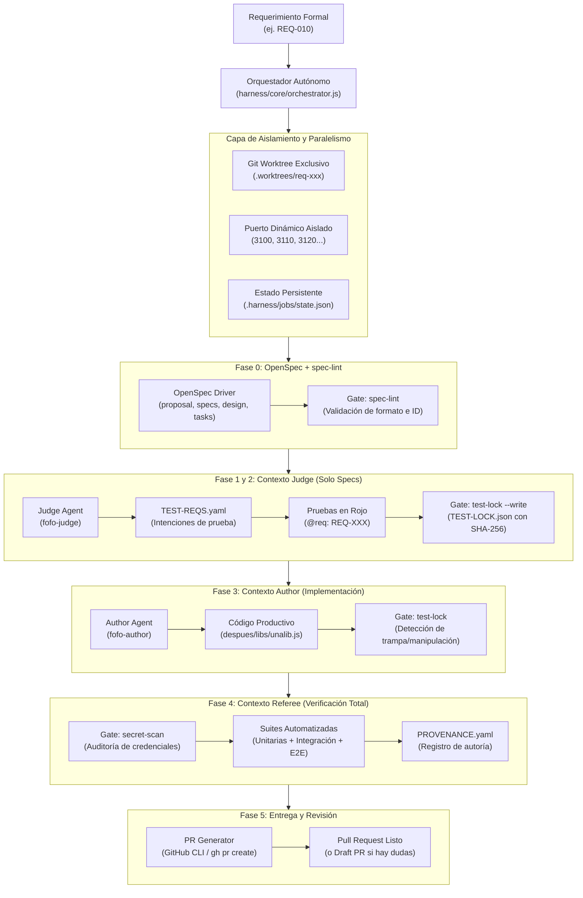

# Arquitectura y Manual Operativo del Harness Autónomo (OpenSpec + FoFo)

**Proyecto:** Laboratorio 5 — Paradigmas de Programación (UNA 2026)  
**Módulo:** Harness Autónomo de Desarrollo Multiagente  
**Rama:** [`feat/autonomous-harness`](file:///C:/Users/cuent/Downloads/Lab5Paradigmas)  

---

## 1. Visión General y Arquitectura

El **Harness Autónomo** es un sistema orquestador diseñado para coordinar el ciclo de vida completo del desarrollo de software asistido por agentes de inteligencia artificial de forma 100% verificable, auditable y segura.

Integra de forma operativa dos marcos de trabajo de vanguardia:
1. **[OpenSpec](https://github.com/Fission-AI/OpenSpec):** Marco de especificación formal orientada a cambios (Spec-Driven Development) que produce artefactos estructurados (`proposal.md`, `specs/`, `design.md`, `tasks.md`).
2. **[FoFo (Agentic-SDLC)](https://github.com/Sweet-Papa-Technologies/Agentic-SDLC):** Marco de control de calidad, aseguramiento de pruebas e integridad mediante la separación estricta de contextos (**Judge vs Author**) y compuertas de calidad deterministas (**Gates**) ejecutadas por el **Referee**.



---

## 2. Instalación y Prerrequisitos

El harness requiere las siguientes herramientas en el sistema anfitrión:

| Herramienta | Versión Mínima / Detectada | Propósito | Verificación |
|---|---|---|---|
| **Git** | 2.40+ (detectado `2.52.0`) | Ramificación y gestión de Git Worktrees concurrentes | `git --version` |
| **Node.js** | 18+ (detectado `v24.14.0`) | Entorno de ejecución del orquestador y suites | `node -v` |
| **npm** | 9+ (detectado `11.6.2`) | Gestión de paquetes y ejecución de scripts | `npm -v` |
| **Python** | 3.10+ (detectado `3.14.0`) | Motor de ejecución de compuertas de seguridad FoFo | `python --version` |
| **OpenSpec CLI** | `@fission-ai/openspec@1.15.0` | Especificación formal delta y validación de esquemas | `npx @fission-ai/openspec@latest --version` |
| **FoFo Scripts** | `Sweet-Papa-Technologies/Agentic-SDLC` | Scripts deterministas de compuertas y arbitraje | `python harness/fofo/scripts/selftest` |
| **GitHub CLI (`gh`)**| `2.103.3` | Creación automatizada y trazabilidad de Pull Requests | `gh --version` |

### Comando de Diagnóstico General
Para verificar el entorno de un solo vistazo:
```bash
node harness/cli.js doctor
```

---

## 3. Separación de Contextos: Judge vs. Author

Una falla recurrente en los flujos de "vibe coding" o desarrollo asistido por IA es que el mismo agente que escribe el código escribe también las pruebas que lo evalúan, lo que genera pruebas triviales, auto-complacientes o que eliminan aserciones cuando encuentran errores.

FoFo y nuestro Harness resuelven esto dividiendo las responsabilidades en dos roles rigurosamente separados:

### 3.1. Rol: Judge (`fofo-judge`)
- **Restricción de Contexto:** El Judge **SOLO** recibe acceso a la especificación (`SPEC.md`, `REQUIREMENTS.md`) y las directrices arquitectónicas. Tiene estrictamente prohibido ver o leer el código de implementación.
- **Salida Fase 1:** Deriva `TEST-REQS.yaml`, mapeando cada ID de requisito (ej. `REQ-010`) a intenciones de prueba concretas que validan comportamientos observables.
- **Salida Fase 2:** Escribe la suite de pruebas unitarias etiquetada con comentarios `@req: REQ-XXX`. Estas pruebas nacen en estado **ROJO** (fallando por ausencia de funcionalidad, nunca por errores de sintaxis).
- **Congelamiento de Pruebas:** Al finalizar la Fase 2, se ejecuta:
  ```bash
  python harness/fofo/scripts/test-lock --write --changed "despues/test/unit/**/*.test.js"
  ```
  Esto genera [`TEST-LOCK.json`](file:///C:/Users/cuent/Downloads/Lab5Paradigmas/harness/fofo/policy.json) con los hashes SHA-256 de cada archivo de prueba y bloquea su edición.

### 3.2. Rol: Author (`fofo-author`)
- **Restricción de Contexto:** El Author recibe la especificación y el código fuente existente, pero **NUNCA** puede alterar las pruebas congeladas.
- **Objetivo:** Implementar código en [`despues/libs/unalib.js`](file:///C:/Users/cuent/Downloads/Lab5Paradigmas/despues/libs/unalib.js) o [`despues/index.html`](file:///C:/Users/cuent/Downloads/Lab5Paradigmas/despues/index.html) hasta que la suite pase a verde.
- **Control Antifraude:** Antes de aceptar cualquier solución, el gate `test-lock` compara los hashes actuales contra `TEST-LOCK.json`. Si el Author intentó modificar, borrar o flexibilizar una prueba para que pase, el gate emite un **código de salida 1 (HARD FAIL)** y aborta el trabajo.

### 3.3. Rol: Referee (Compuertas Automáticas de FoFo)
- Ejecuta los gates de verificación:
  - `spec-lint`: Asegura que cada requisito tenga ID y criterio de `Acceptance:`.
  - `trace-gate`: Asegura que cada requisito tenga pruebas asociadas.
  - `test-lock`: Garantiza que las pruebas no fueron manipuladas.
  - `secret-scan`: Garantiza ausencia de claves AWS, tokens de GitHub o credenciales.
- Registra el manifiesto [`PROVENANCE.yaml`](file:///C:/Users/cuent/Downloads/Lab5Paradigmas/harness/agents/agent-adapter.js) certificando la autoría independiente.

---

## 4. Paralelismo y Aislamiento (3 Trabajos Concurrentes)

El harness permite ejecutar de forma concurrente los tres requerimientos del laboratorio (`REQ-010`, `REQ-011`, `REQ-012`) sin colisiones de recursos mediante:

1. **Git Worktrees Exclusivos:**
   Cada trabajo se ejecuta en su propio directorio físico (`.worktrees/job-xxx`), montado sobre una rama Git independiente (`feat/req-xxx`). No hay conflicto de índices de Git ni sobreescritura de archivos locales.
2. **Puertos Dinámicos Aislados:**
   El módulo [`PortAllocator`](file:///C:/Users/cuent/Downloads/Lab5Paradigmas/harness/core/port-allocator.js) comprueba la disponibilidad en el sistema y asigna un puerto TCP exclusivo a cada trabajo (ejemplo: 3100 para REQ-010, 3110 para REQ-011, 3120 para REQ-012), transmitiéndolo a través de la variable de entorno `PORT`.
3. **Persistencia de Estados y Logs:**
   Cada trabajo mantiene su propio archivo de estado (`.harness/jobs/<job-id>/state.json`) y registros independientes, lo que impide que un error en un trabajo afecte a los demás.

---

## 5. Máquina de Estados y Resiliencia

El ciclo de ejecución transita por estados persistentes y atómicos:

```text
[pending] ──> [specifying] ──> [testing-red] ──> [tests-locked] ──> [implementing] ──> [verifying] ──> [pr-ready] ──> [completed]
     │              │               │                 │                 │                │
     └──> [blocked] (duda de negocio / Draft PR)      └──> [failed] (máx reintentos / error irrecuperable)
```

- **Reanudación Segura:** Si un proceso se interrumpe (cierre de terminal o fallo de red), el comando `node harness/cli.js resume <job-id>` lee el último estado registrado en disco y continúa sin repetir las fases ya aprobadas.
- **Control de Reintentos:** Se contempla un límite estricto de reintentos (`maxRetries = 3`) para evitar bucles infinitos en caso de errores de código o infraestructura.
- **Gestión de Dudas de Negocio:** Cuando un requisito presenta ambigüedades, el harness lo clasifica como `blocked`, documenta la duda en el artefacto de especificación y genera un **Draft Pull Request** en GitHub para revisión humana, sin archivar prematuramente el cambio.

---

## 6. Verificación de Integración Coordinada

Antes de considerar que un conjunto de ramas funcionales está listo para entrega, el harness proporciona un mecanismo de verificación coordinada:

```bash
node harness/cli.js integrate feat/req-010 feat/req-011 feat/req-012
```

**Mecánica Operativa:**
1. Crea una rama y un worktree temporal (`temp/coord-integration-<timestamp>`).
2. Fusiona secuencialmente cada rama funcional sobre la base.
3. Si ocurre un conflicto de Git, reporta los archivos afectados y aborta el merge (`git merge --abort`).
4. Si las ramas se fusionan limpiamente, ejecuta la suite combinada completa (`npm run test:all`).
5. Genera un veredicto estructurado: `CLEAN_INTEGRATION`, `CONFLICT_DETECTED` o `REGRESSION_DETECTED`.
6. **Destruye el worktree y la rama temporal**, asegurando que **NUNCA** se haga un merge automático a `main`.

---

## 7. Manual de Comandos de la CLI

El harness se opera mediante la interfaz de línea de comandos [`harness/cli.js`](file:///C:/Users/cuent/Downloads/Lab5Paradigmas/harness/cli.js):

### 1. Diagnóstico de Prerrequisitos
```bash
node harness/cli.js doctor
```

### 2. Ejecutar un Requerimiento Individual
```bash
node harness/cli.js run REQ-010
```

### 3. Consultar Estado de Trabajos
```bash
# Listar todos los trabajos registrados
node harness/cli.js status

# Consultar el detalle de un trabajo específico
node harness/cli.js status req-010-1730145600000
```

### 4. Reanudar un Trabajo Interrumpido
```bash
node harness/cli.js resume req-010-1730145600000
```

### 5. Ejecución Concurrente por Lotes (3 Requerimientos)
```bash
node harness/cli.js batch REQ-010 REQ-011 REQ-012
```

### 6. Verificación de Integración Conjunta
```bash
node harness/cli.js integrate feat/req-010-prevent-empty-messages feat/req-011-require-username feat/req-012-limit-message-length
```

### 7. Reporte Consolidado de Evidencias
```bash
node harness/cli.js report
```

---

## 8. Procedimiento de Demostración en Clase

Para demostrar el funcionamiento del harness durante la evaluación docente:

1. **Demostración de Prerrequisitos:**
   Ejecutar `node harness/cli.js doctor` para certificar que todos los entornos (Node, Python, Git, OpenSpec, FoFo y gh) están operativos.
2. **Ejecución de Pruebas de Infraestructura del Harness:**
   Ejecutar:
   ```bash
   npx mocha harness/test/harness.infra.test.js
   ```
   Demostrar que pasan las 13 pruebas que certifican:
   - Asignación dinámica de puertos sin colisión.
   - Creación, aislamiento y destrucción de Git Worktrees.
   - Persistencia atómica de estados y recuperación tras fallos.
   - Detección estricta de trampas en pruebas con FoFo `test-lock` (exit code 1).
   - Escaneo determinista de secretos con FoFo `secret-scan`.
   - Detección de conflictos e integraciones coordinadas.
3. **Explicación de la Separación de Roles:**
   Mostrar [`harness/agents/judge-agent.js`](file:///C:/Users/cuent/Downloads/Lab5Paradigmas/harness/agents/judge-agent.js) (spec-only) y [`harness/agents/author-agent.js`](file:///C:/Users/cuent/Downloads/Lab5Paradigmas/harness/agents/author-agent.js) (code-only), demostrando cómo el `test-lock` impide que el Author modifique las aserciones.
4. **Demostración de Ejecución de un Requerimiento (Fase 3B):**
   Demostrar cómo un único comando (`node harness/cli.js run REQ-010`) ejecuta automáticamente el flujo de OpenSpec, genera pruebas rojas, las bloquea, implementa la solución, ejecuta los gates y prepara el Pull Request.
