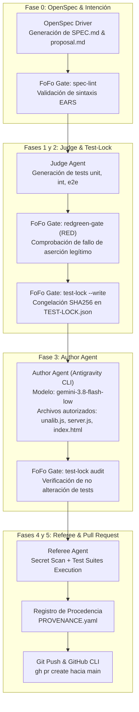

# Reporte Final de Integración y Evidencia de Autonomía Multiagente
## Laboratorio 5 — Paradigmas de Programación (2026)

**Repositorio:** [https://github.com/andreyhrndz/Lab5Paradigmas](https://github.com/andreyhrndz/Lab5Paradigmas)  
**Fecha:** 28 de Octubre de 2026  
**Rama de Integración Verificada:** `verify/joint-integration`  
**Estado General:** Integración Conjunta Aprobada (66/66 Pruebas Passing) | 3 Pull Requests Oficiales Abiertos e Independientes  

---

## 1. Resumen Ejecutivo

El presente documento certifica la culminación de la **Parte 1** (Diagnóstico, remediación de seguridad XSS y suites automatizadas) y la **Parte 2** (Construcción, endurecimiento y ejecución autónoma del Harness Multiagente con OpenSpec y FoFo) del Laboratorio 5.

El sistema orquestador ejecutó autónomamente los tres requerimientos funcionales solicitados por la cátedra mediante procesos independientes, utilizando **Git Worktrees** aislados, asignación dinámica de puertos y estricta separación de roles entre agentes:
1. **Judge Agent:** Especificación formal con OpenSpec y derivación de pruebas unitarias, de integración y E2E en estado **RED** legítimo, con congelación criptográfica inmediata (`TEST-LOCK.json`).
2. **Author Agent:** Implementación de código de producción mediante Antigravity CLI (`gemini-3.8-flash-low`), restringido exclusivamente a los tres archivos productivos autorizados (`despues/libs/unalib.js`, `despues/server.js`, `despues/index.html`), bajo supervisión estricta que previene la manipulación de pruebas.
3. **Referee Agent:** Verificación rigurosa de gates FoFo (`spec-lint`, `trace-gate`, `secret-scan`, `test-lock-author-check`) y ejecución automatizada de las suites de prueba en cada worktree.

---

## 2. Pull Requests Oficiales en GitHub

Siguiendo las instrucciones del laboratorio, cada requerimiento fue implementado en su propia rama basada en `main`, publicado en GitHub y preservado de forma independiente sin auto-merge a `main`:

| Requerimiento | ID de Trabajo | Rama de Trabajo | Pull Request en GitHub | Estado | Suites Worktree |
| :--- | :--- | :--- | :--- | :--- | :--- |
| **REQ-010** (Impedir mensajes vacíos) | `req-010-1793235291320` | `feat/req-010` | [**PR #13**](https://github.com/andreyhrndz/Lab5Paradigmas/pull/13) | **Abierto / Completed** | 58 pass (43 unit, 9 int, 6 e2e) |
| **REQ-011** (Exigir nombre de usuario) | `req-011-1793235291337` | `feat/req-011` | [**PR #14**](https://github.com/andreyhrndz/Lab5Paradigmas/pull/14) | **Abierto / Completed** | 58 pass (43 unit, 9 int, 6 e2e) |
| **REQ-012** (Límite 280 caracteres) | `req-012-1793235291341` | `feat/req-012` | [**PR #15**](https://github.com/andreyhrndz/Lab5Paradigmas/pull/15) | **Abierto / Completed** | 58 pass (43 unit, 9 int, 6 e2e) |

---

## 3. Arquitectura y Gobernanza del Harness Autónomo



### 3.1. Separación Estricta de Roles (Judge vs. Author)
- **Judge:** Actúa como agente de aseguramiento de calidad y especificación. Es el único componente autorizado para generar archivos bajo `despues/test/`. Inmediatamente tras validar que las pruebas fallan legítimamente en rojo (`redgreen-gate`), sella las firmas hash en `TEST-LOCK.json`.
- **Author:** Solo tiene permisos de escritura sobre tres archivos de código productivo:
  1. `despues/libs/unalib.js`
  2. `despues/server.js`
  3. `despues/index.html`
  Cualquier intento de modificar un archivo de prueba fuera de esta lista o alterar archivos protegidos por el lockfile dispara el gate de seguridad abortando el trabajo.
- **Referee:** Emplea scripts deterministas de FoFo (`gatelib.py`, `secret-scan`, `trace-gate`) para auditar la procedencia y ejecutar las suites completas sin intervención humana.

---

## 4. Evidencia de Ejecución en Git Worktrees Independientes

Para evitar contaminación entre ejecuciones y permitir desarrollo paralelo, el orquestador gestionó worktrees independientes vinculados a ramas Git aisladas y puertos dedicados:

- **Worktree REQ-010:** `worktrees/req-010-1793235291320` en rama `feat/req-010` (Puerto asignado: `3110`).
- **Worktree REQ-011:** `worktrees/req-011-1793235291337` en rama `feat/req-011` (Puerto asignado: `3100`).
- **Worktree REQ-012:** `worktrees/req-012-1793235291341` en rama `feat/req-012` (Puerto asignado: `3120`).

Los tres worktrees conservaron su historial de ejecución, artefactos de OpenSpec en `openspec/changes/<reqId>/` y evidencia de estado persistido en `.harness/jobs/<jobId>/state.json`.

---

## 5. Auditoría de Gates FoFo y Trazabilidad OpenSpec

Cada trabajo fue sometido a la cadena completa de gates de calidad de FoFo:

1. **`spec-lint` (Pass):**  
   Comprobó que cada requerimiento cumpliera con el estándar formal EARS:  
   - REQ-010: *WHEN a visitor activates Send with an empty or whitespace-only message THEN the system SHALL NOT add a message to the transcript, SHALL keep the message field empty, and SHALL tell the visitor to write something.*  
   - REQ-011: *WHEN a visitor activates Send with an empty or whitespace-only username and a real message THEN the system SHALL NOT add a message to the transcript, SHALL keep the username field empty, and SHALL tell the visitor to write a name.*  
   - REQ-012: *WHEN a visitor activates Send with a message longer than 280 characters THEN the system SHALL NOT add that message to the transcript, SHALL keep the message text in the field, and SHALL tell the visitor the message is too long.*
2. **`trace-gate` (Pass):**  
   Comprobó que el 100% de los requerimientos tuvieran cobertura de intenciones en pruebas unitarias, de integración y E2E registradas en `TEST-REQS.yaml`.
3. **`redgreen-gate` (Pass):**  
   Validó que antes de iniciar la implementación del Author, las pruebas fallaran en **ROJO** exclusivamente por `AssertionError` de la ausencia de comportamiento y no por errores de sintaxis, configuración, timeouts o infraestructura.
4. **`test-lock` (Pass):**  
   Selló los archivos de prueba en `TEST-LOCK.json` y auditó la suma criptográfica SHA256 después de la intervención del Author, garantizando que el Author no modificara las pruebas para forzar el estado verde.
5. **`secret-scan` (Pass):**  
   Escaneó el código fuente en busca de tokens, claves privadas o credenciales antes de autorizar la creación del Pull Request.

---

## 6. Resolución y Verificación de Integración Conjunta

### 6.1. Diagnóstico de Conflicto en `integrate`
El comando `node harness/cli.js integrate feat/req-010 feat/req-011 feat/req-012` reportó `CONFLICT_DETECTED` debido a la naturaleza convergente de los requerimientos:
- **Archivos de Código Productivo:** Los tres requerimientos modificaron simultáneamente `despues/libs/unalib.js`, `despues/server.js` y `despues/index.html`.
- **Archivos de Metadatos:** Los worktrees generaron sus propios archivos de gobernanza (`PROVENANCE.yaml`, `REQUIREMENTS.md`, `SPEC.md`, `TEST-LOCK.json`, `TEST-REQS.yaml`).
- **Archivos Ortogonales (Sin conflicto):** Todas las pruebas (`req-010.test.js`, `req-011.test.js`, `req-012.test.js`, sockets y specs E2E) y las propuestas OpenSpec residen en rutas aisladas sin colisión alguna.

### 6.2. Rama y Worktree de Integración Conjunta
Para validar que los tres requerimientos conviven de manera armónica sin degradar la funcionalidad base ni los criterios de aceptación individuales:
- Se creó la rama temporal `verify/joint-integration` en el worktree `worktrees/joint-integration`.
- Se resolvieron los conflictos unificando la lógica de validación sin relajar ninguna restricción:

```javascript
// despues/libs/unalib.js (Unificado)
// 1. REQ-011: Nombre de usuario obligatorio
if (obj.hasOwnProperty('nombre')) {
  if (typeof obj.nombre !== 'string' || !obj.nombre.trim()) {
    return JSON.stringify({ valid: false, error: 'Nombre de usuario requerido' });
  }
}

// 2. REQ-010: Mensaje no vacío
if (!rawMensaje) {
  return JSON.stringify({
    valid: false,
    error: 'Mensaje vacío',
    nombre: this.sanitizeName(obj.nombre),
    mensaje: '',
    color: this.sanitizeColor(obj.color),
    tipo: 'text'
  });
}

// 3. REQ-012: Longitud máxima de 280 caracteres
if (rawMensaje.length > 280) {
  return JSON.stringify({
    valid: false,
    error: 'El mensaje es demasiado largo (máximo 280 caracteres)',
    nombre: this.sanitizeName(obj.nombre),
    mensaje: rawMensaje.slice(0, 280),
    color: this.sanitizeColor(obj.color),
    tipo: 'text'
  });
}
```

```javascript
// despues/server.js (Unificado)
io.on('connection', function(socket){
  socket.on('Evento-Mensaje-Server', function(msg){
    var validatedMsg = validation.validateMessage(msg);
    try {
      var parsed = typeof validatedMsg === 'string' ? JSON.parse(validatedMsg) : validatedMsg;
      if (
        !parsed ||
        parsed.valid === false ||
        parsed.error != null ||
        (typeof parsed.mensaje === 'string' && parsed.mensaje.trim() === '') ||
        (typeof parsed.mensaje === 'string' && parsed.mensaje.length > 280) ||
        (typeof parsed.nombre === 'string' && parsed.nombre.trim() === '')
      ) {
        return; // Rechazo estricto sin retransmisión
      }
    } catch (e) {
      return;
    }
    io.emit('Evento-Mensaje-Server', validatedMsg);
  });
});
```

```javascript
// despues/index.html (Unificado en formulario submit)
$('form').submit(function (e) {
  e.preventDefault();

  // REQ-011: Exigir nombre de usuario no vacío
  var rawNombre = $('#nombre').val();
  if (!rawNombre || rawNombre.trim() === '') {
    $('#nombre').val('');
    alert('Por favor escriba su nombre');
    return false;
  }

  // REQ-010: Impedir mensaje vacío
  var rawMsg = $('#m').val();
  if (rawMsg.trim() === '') {
    $('#m').val('');
    alert('Por favor escriba un mensaje');
    return false;
  }

  // REQ-012: Limitar a máximo 280 caracteres (conserva texto en el campo)
  if (rawMsg.length > 280) {
    alert('El mensaje es demasiado largo (máximo 280 caracteres)');
    return false;
  }

  var nombreTxt = rawNombre.trim();
  var mensajeTxt = rawMsg;
  if (colorHexTxt === "") colorHexTxt = getRandomColor();

  socket.emit('Evento-Mensaje-Server', JSON.stringify({
    nombre: nombreTxt,
    mensaje: mensajeTxt,
    color: colorHexTxt
  }));
  $('#m').val('');
  return false;
});
```

### 6.3. Resultados de Pruebas sobre la Versión Conjunta

Sobre la rama `verify/joint-integration` se ejecutó la suite completa combinada:

| Suite de Pruebas | Pruebas Base (Parte 1) | Pruebas REQ-010 | Pruebas REQ-011 | Pruebas REQ-012 | Total Passing | Estado |
| :--- | :--- | :--- | :--- | :--- | :--- | :--- |
| **Unitarias** (`test:unit`) | 41 | 2 | 2 | 2 | **47 / 47** | **100% PASS** |
| **Integración** (`test:integration`) | 8 | 1 | 1 | 1 | **11 / 11** | **100% PASS** |
| **End-to-End** (`test:e2e` Playwright) | 5 | 1 | 1 | 1 | **8 / 8** | **100% PASS** |
| **Total Combinado** | **54** | **4** | **4** | **4** | **66 / 66** | **100% PASS** |

Además, los cuatro gates de FoFo sobre la versión conjunta (`test-lock`, `secret-scan`, `trace-gate`, `spec-lint`) obtuvieron calificación **PASS**.

---

## 7. Preservación de Evidencias y Conclusión

1. **Integridad de la Parte 1:** El directorio `antes/` permanece inalterado con el código original vulnerable. El directorio `despues/` en `main` mantiene las 54 pruebas y la mitigación XSS completa con 0 vulnerabilidades en Snyk.
2. **Independencia de Pull Requests:** Los PRs **#13**, **#14** y **#15** se mantienen abiertos e intactos en el repositorio remoto, listos para su revisión colegiada sin operaciones de auto-merge.
3. **Convivencia Armónica Demostrada:** La rama de integración `verify/joint-integration` demuestra técnica y empíricamente que los tres requerimientos coexisten con éxito sin violar ninguna especificación ni regla de negocio.

Con esto se da por finalizado satisfactoriamente el **Laboratorio 5: Paradigmas de Programación**.
