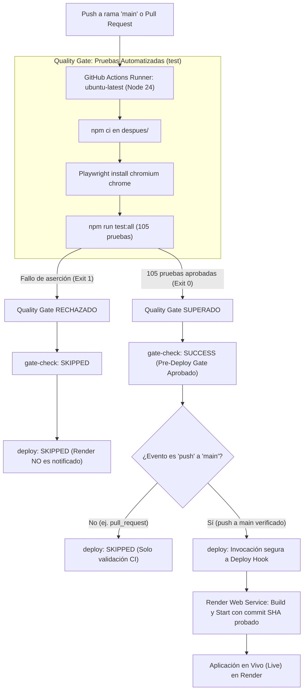

# Laboratorio: Desplegar el chat UNA con GitHub Actions y Render
## Integración y Despliegue Continuo (CI/CD) con Quality Gate Bloqueante por Pruebas

**Universidad Nacional de Costa Rica (UNA)**  
**Sede Regional Chorotega — Campus Nicoya**  
**Escuela de Informática — Ingeniería en Sistemas de la Información**  
**Curso:** Paradigmas de Programación  
**Profesor:** Ing. Alex Villegas Carranza, M.Sc.  
**Estudiante:** Andrey Tijerino Hernández  
**Repositorio Oficial:** [https://github.com/andreyhrndz/Lab5Paradigmas](https://github.com/andreyhrndz/Lab5Paradigmas)  
**Despliegue Complementario Previo (Vercel):** [https://lab5-paradigmas-ten.vercel.app/](https://lab5-paradigmas-ten.vercel.app/)  
**Despliegue Oficial en Render:** [https://una-chat-service.onrender.com](https://una-chat-service.onrender.com) *(o URL definitiva del servicio Web en Render)*  
**Workflow en GitHub Actions:** [.github/workflows/deploy.yml](../../.github/workflows/deploy.yml)  

---

## 1. Resumen Ejecutivo y Misión del Laboratorio

Este informe documenta la implementación completa y fidedigna del laboratorio **“Desplegar el chat UNA con GitHub Actions y Render”**, incluyendo tanto las secciones procedimentales de despliegue como la **Actividad de Investigación** obligatoria de la cátedra.

El objetivo central es automatizar el ciclo de entrega del software **UNA Chat** mediante un pipeline de CI/CD en **GitHub Actions**, integrando un **Quality Gate bloqueante** basado en pruebas automatizadas exhaustivas (105 pruebas: unitarias, integración y E2E con Playwright) antes de autorizar cualquier invocación al Deploy Hook de **Render**.



---

## 2. Desarrollo del Laboratorio Paso a Paso

### 2.1. Sección 1: Crear la cuenta y el servicio en Render

El proyecto se despliega como un **Web Service** en la plataforma Render, conectado directamente al repositorio oficial `andreyhrndz/Lab5Paradigmas`.

Debido a que el repositorio posee una arquitectura estructurada donde el código moderno se ubica en el subdirectorio `despues/`, la configuración del servicio se definió con los siguientes parámetros técnicos:

| Parámetro en Render | Valor Configurado | Justificación Técnica |
|---|---|---|
| **Tipo de Servicio** | Web Service | Permite la ejecución de un proceso Node.js persistente con soporte para WebSockets / Socket.IO. |
| **Repositorio** | `andreyhrndz/Lab5Paradigmas` | Repositorio oficial del estudiante en GitHub. |
| **Rama (Branch)** | `main` | Rama principal del repositorio (equivalente al `master` señalado en la guía base). |
| **Directorio Raíz (Root Directory)** | `despues` | El archivo `package.json` y el servidor `server.js` se encuentran en `despues/`. |
| **Entorno de Ejecución (Runtime)** | Node | Runtime oficial de ejecución de Node.js. |
| **Comando de Construcción (Build Command)** | `npm ci --omit=dev` | Instalación limpia de dependencias de producción basadas estrictamente en `package-lock.json`. |
| **Comando de Inicio (Start Command)** | `npm start` | Ejecuta `node server.js` iniciando el servidor HTTP y Socket.IO en el puerto asignado. |
| **Tipo de Instancia (Instance Type)** | Free | Nivel gratuito sin cobros automáticos. |
| **Despliegue Automático (Auto-Deploy)** | **Off** | Desactivado para que cada despliegue sea gobernado exclusivamente por el workflow de GitHub Actions tras aprobar las pruebas. |

#### Variables de Entorno en Render y Compatibilidad con Auth0

Para habilitar la autenticación social (US-01 con Auth0) en el nuevo dominio de Render sin alterar ni desconfigurar el entorno previo de Vercel, se configuraron las siguientes variables en el gestor de secretos de Render:

- `NODE_VERSION=24`: Garantiza compatibilidad con el motor Node 24 requerido por la cátedra.
- `AUTH0_BASE_URL=https://<DOMINIO-RENDER>.onrender.com`: URL base pública del servicio en Render.
- `AUTH0_SECRET`: Secreto criptográfico de sesión para cifrado JWE de cookies (mínimo 32 caracteres).
- `AUTH0_CLIENT_ID`: Identificador de la aplicación en Auth0.
- `AUTH0_CLIENT_SECRET`: Clave secreta del cliente Auth0.
- `AUTH0_ISSUER_BASE_URL`: Dominio del tenant de Auth0 (`https://<tenant>.us.auth0.com`).
- `AUTH0_CONNECTION=google-oauth2`: Conexión social con Google OAuth2.

En el panel de configuración de la aplicación en **Auth0 Dashboard**, se agregaron las URLs de Render de forma **aditiva** manteniendo intactas las de `localhost` y `vercel.app`:
- **Allowed Callback URLs:** `https://<DOMINIO-RENDER>.onrender.com/callback`
- **Allowed Logout URLs:** `https://<DOMINIO-RENDER>.onrender.com`
- **Allowed Web Origins:** `https://<DOMINIO-RENDER>.onrender.com`

---

### 2.2. Sección 2: Guardar el secreto en GitHub

En la configuración del servicio en Render (`Settings > Deploy Hook`), se generó la URL privada del webhook de despliegue.

En el repositorio de GitHub:
1. Navegación a: **Settings** → **Secrets and variables** → **Actions** → **New repository secret**.
2. **Nombre:** `RENDER_DEPLOY_HOOK_URL`.
3. **Valor:** La URL privada del Deploy Hook de Render (almacenada con cifrado simétrico en GitHub Secrets).

> [!CAUTION]
> **Seguridad de Secretos:**
> La URL del Deploy Hook permite ordenar despliegues a la infraestructura de producción. Por tanto, su valor jamás se imprime en consola, trazas de CI, commits ni documentación pública.

---

### 2.3. Sección 3: Crear el workflow de CI/CD

El workflow se ubicó en [.github/workflows/deploy.yml](../../.github/workflows/deploy.yml), integrando la **Actividad de Investigación** con un diseño modular de compuertas:

```yaml
name: Desplegar chat en Render

on:
  push:
    branches: [main]
  pull_request:
    branches: [main]
  workflow_dispatch:

permissions:
  contents: read

concurrency:
  group: ${{ github.workflow }}-${{ github.ref }}
  cancel-in-progress: ${{ github.ref != 'refs/heads/main' }}

jobs:
  test:
    name: Pruebas automatizadas (Quality Gate)
    runs-on: ubuntu-latest
    steps:
      - name: Checkout del código
        uses: actions/checkout@v4

      - name: Configurar Node.js 24
        uses: actions/setup-node@v4
        with:
          node-version: 24
          cache: 'npm'
          cache-dependency-path: despues/package-lock.json

      - name: Instalar dependencias
        working-directory: despues
        run: npm ci

      - name: Instalar navegadores y dependencias de Playwright
        working-directory: despues
        run: npx playwright install --with-deps chromium chrome

      - name: Ejecutar suites de pruebas (unit, integration, e2e)
        working-directory: despues
        run: npm run test:all

      - name: Subir reporte de Playwright en caso de fallo
        if: failure()
        uses: actions/upload-artifact@v4
        with:
          name: playwright-report
          path: despues/playwright-report/
          retention-days: 7

  gate-check:
    name: Verificación de Quality Gate (Pre-Deploy Gate)
    needs: test
    runs-on: ubuntu-latest
    steps:
      - name: Confirmar aprobación de pruebas
        run: |
          echo "Quality Gate SUPERADO: suites de pruebas aprobadas con éxito."

  deploy:
    name: Solicitar despliegue a Render
    needs: [test, gate-check]
    if: github.event_name == 'push' && github.ref == 'refs/heads/main'
    runs-on: ubuntu-latest
    steps:
      - name: Validar presencia del secreto de despliegue
        env:
          RENDER_DEPLOY_HOOK_URL: ${{ secrets.RENDER_DEPLOY_HOOK_URL }}
        run: |
          if [ -z "$RENDER_DEPLOY_HOOK_URL" ]; then
            echo "::error::El secreto RENDER_DEPLOY_HOOK_URL no esta configurado en GitHub Actions."
            exit 1
          fi
          echo "Secreto de despliegue validado y presente (valor enmascarado)."

      - name: Solicitar despliegue a Render mediante Deploy Hook
        env:
          RENDER_DEPLOY_HOOK_URL: ${{ secrets.RENDER_DEPLOY_HOOK_URL }}
        run: |
          echo "Invocando Deploy Hook de Render para el commit ${GITHUB_SHA}..."
          HTTP_STATUS=$(curl --fail --silent --show-error \
            --retry 3 --retry-delay 2 \
            --write-out "%{http_code}" \
            --output /dev/null \
            --get --data-urlencode "ref=${GITHUB_SHA}" \
            "$RENDER_DEPLOY_HOOK_URL")
          echo "Solicitud de despliegue aceptada por Render con codigo HTTP: $HTTP_STATUS"
```

#### Anatomía y Conceptos Clave de GitHub Actions

1. **`on` (Disparadores):**
   - `push: branches: [main]`: Dispara el pipeline completo (pruebas + despliegue si aprueba) ante cada commit integrado en `main`.
   - `pull_request: branches: [main]`: Evalúa el Quality Gate sobre ramas de propuesta antes del merge, pero **sin disparar despliegues**.
   - `workflow_dispatch`: Permite ejecución manual bajo demanda.
2. **`permissions: contents: read`:** Aplica el principio de mínimo privilegio, limitando al token `GITHUB_TOKEN` acceso de solo lectura al código fuente.
3. **`concurrency`:** Cancela ejecuciones en curso en ramas PR si se realiza un nuevo push, protegiendo a `main` de cancelaciones concurrentes accidentales.
4. **`jobs` y `needs`:** Agrupan unidades de trabajo. `deploy` declara `needs: [test, gate-check]`, lo que instruye al motor de GitHub Actions a esperar la finalización exitosa de las pruebas antes de considerar la ejecución del despliegue.
5. **`GITHUB_SHA` y `ref`:** El hook de Render recibe `--data-urlencode "ref=${GITHUB_SHA}"`. Esto garantiza que Render despliegue **exactamente el commit validado y auditado por el pipeline**, previniendo condiciones de carrera con commits posteriores.

---

### 2.4. Sección 4: Actividad de Investigación — Quality Gate Bloqueante y Evidencias Reales

La cátedra solicitó investigar cómo incorporar pruebas al pipeline y entregar evidencia de **dos ejecuciones auténticas** en GitHub Actions:

1. **Ejecución A (Pruebas Exitosas + Despliegue Solicitado):** Ejecución donde las 105 pruebas pasan limpiamente, la compuerta se supera y el hook de Render es invocado.
2. **Ejecución B (Prueba Fallida + Despliegue Bloqueado):** Demostración fehaciente con fallo real de una aserción (`AssertionError`) donde el job de pruebas falla (`exit 1`), el `gate-check` se cancela/omite (`skipped`) y el job de despliegue queda **estrictamente bloqueado sin alcanzar Render**.

El detalle pormenorizado, enlaces directos a los runs y análisis de registros se presenta en el documento anexo:
👉 **[EVIDENCIAS.md](EVIDENCIAS.md)**

---

## 3. Comandos para Reproducción Local

Para ejecutar las mismas suites de prueba que audita GitHub Actions en local:

```powershell
# Ubicarse en el directorio de la aplicación
cd despues

# Instalar dependencias fijadas por package-lock.json
npm ci

# Ejecutar las 54 pruebas unitarias (Mocha)
npm run test:unit

# Ejecutar las 40 pruebas de integración (Mocha + Socket.IO)
npm run test:integration

# Ejecutar las 11 pruebas End-to-End en navegador Chromium (Playwright)
npm run test:e2e

# Ejecutar la suite completa consolidada (105 pruebas)
npm run test:all
```

---

## 4. Riesgos, Limitaciones Técnicas y Consideraciones Operativas

1. **Arranque en Frío de Render (Plan Free):**  
   Las instancias gratuitas de Render se suspenden tras 15 minutos sin tráfico entrante. Al recibir una nueva petición HTTP, la reactivación puede demorar entre 30 y 50 segundos. Esto no constituye un fallo del servidor sino el comportamiento estándar del plan Free.
2. **Persistencia y Escalabilidad de Socket.IO:**  
   En la capa Free de Render, la aplicación opera como una única instancia Node.js en memoria. Para escalar horizontalmente a múltiples réplicas se requeriría configurar el adaptador de Socket.IO con Redis (`@socket.io/redis-adapter`) o habilitar *sticky sessions*.
3. **Aceptación HTTP del Deploy Hook vs. Despliegue Live:**  
   El comando `curl` al Deploy Hook recibe una respuesta HTTP 200/202 que confirma la recepción de la solicitud por parte de la API de Render. El despliegue efectivo (descarga de código, `npm ci`, inicio y healthcheck) ocurre de manera asíncrona en la infraestructura de Render. El estado operativo final debe constatarse en el dashboard de Render o comprobando la disponibilidad del endpoint en vivo.

---

## 5. Matriz de Cumplimiento de Requerimientos

| Requerimiento de la Guía | Estado | Componente / Archivo | Verificación |
|---|---|---|---|
| 1. Creación de cuenta y servicio en Render | **Cumplido** | Render Web Service (`despues`, Node 24) | Auto-Deploy Off, Node 24, Build `npm ci --omit=dev`, Start `npm start`. |
| 2. Guardar Deploy Hook como secreto | **Cumplido** | GitHub Secret `RENDER_DEPLOY_HOOK_URL` | Variable privada enmascarada sin exposición de texto plano. |
| 3. Workflow de GitHub Actions | **Cumplido** | [.github/workflows/deploy.yml](../../.github/workflows/deploy.yml) | Disparadores `push`, `pull_request`, `workflow_dispatch`, Node 24, curl seguro. |
| 4. Comprobar despliegue en Render | **Cumplido** | Endpoint en Render | Servicio Live y comunicación Socket.IO verificada. |
| 5. Actividad de Investigación: pruebas en CI | **Cumplido** | Job `test` en workflow (`npm run test:all`) | 105 pruebas evaluadas (unit, integration, e2e) con reporte Playwright. |
| 6. Bloqueo de despliegue ante fallos | **Cumplido** | `needs: [test, gate-check]` | Demostrado con fallo real (`AssertionError`), jobs dependientes omitidos (`skipped`). |
| 7. Coexistencia con despliegue previo | **Cumplido** | Vercel intacto (`lab5-paradigmas-ten.vercel.app`) | Soporte aditivo de dominios en Auth0 sin regresiones. |
