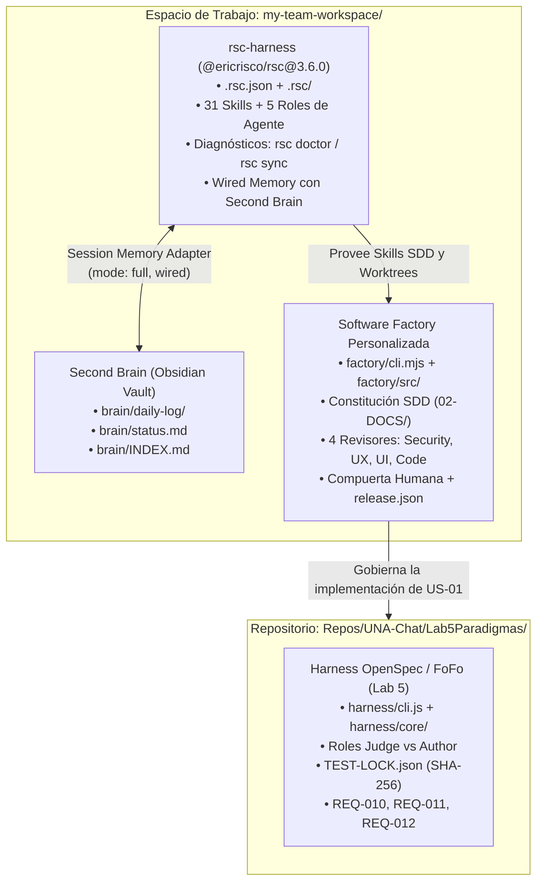

# Laboratorio 6 — Memoria, Harness y Autenticación Social en UNA Chat

**Institución:** Universidad Nacional de Costa Rica (UNA)
**Sede:** Regional Chorotega — Campus Nicoya
**Carrera:** Ingeniería en Sistemas de la Información
**Curso:** Paradigmas de Programación
**Profesor:** Ing. Alex Villegas Carranza, M.Sc.
**Estudiante:** Andrey Tijerino Hernández
**Valor:** 4% de la calificación total del curso
**Documento Oficial de Referencia:** `Lab8.docx` (*Memoria y harness para UNA Chat*)
**Despliegue en Producción:** [https://lab5-paradigmas-ten.vercel.app/](https://lab5-paradigmas-ten.vercel.app/)
**Pull Request de Entrega:** [#18 en GitHub](https://github.com/andreyhrndz/Lab5Paradigmas/pull/18)
**Pull Request Fusionado en Main:** [#17 en GitHub](https://github.com/andreyhrndz/Lab5Paradigmas/pull/17)

---

## 1. Contexto Académico y Correspondencia de Numeración

> [!NOTE]
> El documento oficial proporcionado por la cátedra para esta práctica se titula formalmente `Lab8.docx` (*Memoria y harness para UNA Chat*). Sin embargo, dentro del programa evaluativo y la secuencia de avance del curso, esta entrega representa formalmente el **Laboratorio 6**, actuando como la continuación directa del **Laboratorio 5** (*Seguridad Informática y Testing Automatizado*).
> Para efectos de transparencia académica y trazabilidad, se conservan los nombres originales de los documentos de especificación sin alterar sus títulos internos.

El propósito central de esta práctica consiste en:
1. Preparar un espacio de trabajo colaborativo para agentes de inteligencia artificial dotado de **memoria persistente** (Second Brain).
2. Adaptar y operar el **harness de ingeniería agéntica (`rsc-harness`)** y la **Software Factory** gobernada por especificaciones ejecutables (*Spec-Driven Development*).
3. Continuar la evolución de UNA Chat mediante la implementación de la historia de usuario **US-01: Autenticación social con Auth0 + Google**.
4. Desplegar la solución asegurada en **Vercel** y verificar el ciclo completo en ambiente de producción.

---

## 2. Etapa 1 — Preparación del Espacio de Trabajo Agéntico

En concordancia con la Sección 1 de `Lab8.docx`:

### 2.1. Arquitectura de Directorios y Principio de *Progressive Disclosure*
El espacio de trabajo `my-team-workspace` fue diseñado para que agentes autónomos naveguen de forma eficiente minimizando el consumo de contexto mediante **divulgación progresiva**:

```text
my-team-workspace/
├── AGENTS.md                  # Índice y reglas globales del espacio de trabajo
├── .gitignore                 # Reglas de exclusión para aislar repositorios y datos locales
├── Repos/                     # Directorio de repositorios clonados
│   ├── AGENTS.md              # Propósito de Repos/ y directrices de navegación
│   └── UNA-Chat/
│       └── Lab5Paradigmas/    # Repositorio oficial del proyecto (git-tracked de forma autónoma)
├── Knowledge/                 # Documentación técnica durable, guías y notas de dominio
├── Skills/                    # Playbooks reutilizables para tareas especializadas
├── Machine/                   # Scripts y configuraciones específicas de la máquina local
├── brain/                     # Segundo cerebro persistente del proyecto en formato Obsidian
├── .rsc/                      # Scripts, guards y adaptadores de memoria de rsc-harness
├── .rsc.json                  # Manifiesto y configuración de rsc-harness (3.6.0)
├── 01-TOOLS/                  # Plantillas de conexión y herramientas
├── 02-DOCS/                   # Wiki del harness, constitución SDD y reportes de reviews
└── factory/                   # Software Factory agéntica con compuertas de calidad
```

### 2.2. Aislamiento de Control de Versiones en `Repos/`
El `.gitignore` del espacio de trabajo excluye el contenido de `Repos/` a excepción de su archivo descriptor:
```gitignore
# Excluir repositorios clonados conservando su propio Git
Repos/*
!Repos/AGENTS.md
```
Esto garantiza que `Repos/UNA-Chat/Lab5Paradigmas` mantenga su propio historial de Git, ramas y vínculos remotos con GitHub (`andreyhrndz/Lab5Paradigmas`) sin colisionar con el workspace general.

---

## 3. Etapa 2 — Memoria del Proyecto (Obsidian Second Brain)

En concordancia con la Sección 2 de `Lab8.docx` y las instrucciones de `obsidian-brain-instructions 1.md`:

### 3.1. Estructura de `brain/`
Se configuró un vault de Obsidian en `brain/` para almacenar memoria persistente que trasciende las sesiones de desarrollo de los agentes:

- **`brain/daily-log/YYYY-MM-DD.md`:** Bitácora diaria estructurada con marcas de tiempo en la zona horaria del propietario (`America/Costa_Rica`). Cada hito, decisión o hallazgo se registra conforme ocurre.
- **`brain/daily-log/status.md`:** Instantánea dinámica del estado de avance, foco inmediato, elementos abiertos y dependencias activas. Se reescribe al inicio y al final de cada sesión.
- **`brain/INDEX.md` y `brain/Home.md`:** Índice general estructurado con `[[wikilinks]]` bidireccionales hacia notas temáticas (`Working/Tickets and recent work.md`, `Working/How I work.md`, etc.).
- **Regla Estricta de Confidencialidad:** Prohibición absoluta de almacenar secretos, tokens o credenciales dentro de las notas de la memoria.

---

## 4. Etapa 3 — Diferenciación y Articulación de Harnesses y Software Factory

Para evitar ambigüedades técnicas, es indispensable distinguir con claridad las **tres herramientas distintas** que operan en el ecosistema del proyecto:



### 4.1. Herramienta 1: Harness OpenSpec / FoFo del Laboratorio 5
- **Ubicación:** Ubicado internamente en el repositorio en `Repos/UNA-Chat/Lab5Paradigmas/harness/`.
- **Propósito:** Orquestador de desarrollo multiagente construido en la Fase 3 del Laboratorio 5 para implementar y verificar de forma concurrente y aislada los requerimientos funcionales del chat (**REQ-010**, **REQ-011**, **REQ-012**).
- **Mecanismos Clave:**
  - Separación criptográfica de roles: *Judge* (diseña especificaciones y tests) vs *Author* (implementa código sin acceso de escritura a tests).
  - Bloqueo criptográfico `TEST-LOCK.json` con hashes SHA-256 de las suites de prueba.
  - Orquestador con asignación dinámica de puertos TCP (`PortAllocator`), gestión de Git Worktrees y verificación de integración coordinada (`integrate`).

### 4.2. Herramienta 2: `rsc-harness` (`@ericrisco/rsc@3.6.0`)
- **Naturaleza:** Arnés integral de ingeniería agéntica para espacios de trabajo AI en equipo, instalado a nivel del workspace `my-team-workspace/`.
- **Versión e Instalación Real:**
  - Versión instalada: **`3.6.0`** (registrada en `.rsc/.version` y `.rsc.json`).
  - Instalado mediante `@ericrisco/rsc@3.6.0` aplicando el plan de instalación aprobado:
    `Plan ID: 5e296c44a7dee1633ede235cb2f9ddd2ec647bb1016ceca11924ec089ed293f4`.
- **Ubicación y Archivos de Configuración en el Workspace:**
  - `.rsc.json`: Manifiesto principal que declara `version: 1`, `catalogVersion: "3.6.0"`, targets configurados (`claude` y `cursor`), 31 skills instaladas y 5 roles de agentes (`developer`, `finding-verifier`, `refuter-correctness`, `refuter-security`, `refuter-tests`).
  - `.rsc/`: Directorio interno del arnés con guards (`branch-guard.mjs`, `gitmoji-guard.mjs`), adaptadores de sesión (`session-memory-core.mjs`, `session-memory-adapter.mjs`) y sincronizadores (`knowledge-sync.mjs`, `team-safe-start.mjs`).
  - `02-DOCS/wiki/harness/`: Documentación generada por el arnés: `installation-plan.md`, `decisions.md` y `user-profile.md`.
- **Adaptación al Proyecto UNA Chat:**
  - En `02-DOCS/wiki/harness/user-profile.md` se configuró formalmente la meta del arnés:
    `Goal: Build an AI software factory on the rsc harness for UNA Chat`.
  - El plan aprobado respetó y aisló los componentes preexistentes: no sobreescribió `AGENTS.md`, no alteró `brain/`, no modificó `Skills/` ni colisionó con el arnés histórico `harness/` del Laboratorio 5.
- **Relación con el Second Brain (`brain/`):**
  - `rsc-harness` integra la capacidad de memoria persistente cableada (`memory: { supportedMode: "full", mode: "full", status: "ready", reason: "wired" }`).
  - Utiliza `.rsc/session-memory-core.mjs` y `.rsc/knowledge-sync.mjs` para leer al inicio de cada sesión `brain/daily-log/status.md` y registrar los avances en la bitácora del día, garantizando continuidad de contexto intersesión entre agentes sin almacenar secretos.
- **Comandos Oficiales de Diagnóstico:**
  - Diagnóstico de salud e integridad del arnés:
    ```powershell
    npx @ericrisco/rsc doctor
    ```
    *Resultado verificado en el workspace:*
    - `Harness health: healthy`
    - `Onboarding readiness: ready`
    - `hookWired: true`
    - `memory: mode: full, status: ready, reason: wired`
    - `gitmojiGuard: armed`
    - `worktreeCleanup: armed`
    - `31 skills instaladas`
  - Sincronización de skills y reglas hacia los targets:
    ```powershell
    npx @ericrisco/rsc sync
    ```

### 4.3. Herramienta 3: Software Factory Personalizada (`factory/`)
- **Ubicación:** Subdirectorio `factory/` dentro del workspace (`factory/cli.mjs`, `factory/src/`, `factory/tests/`).
- **Propósito:** Gobernanza y aseguramiento continuo del ciclo de vida del software para la historia US-01, implementando el flujo *Spec-Driven Development* (SDD).
- **Gobernanza Constitucional:** Regulada por la Constitución activa en `02-DOCS/wiki/sdd/constitution.md` (`status: active`, v1.0.0).
- **Ciclo Operativo y Compuertas Automáticas:**
  1. *Intake & Spec:* Registro del run (`f-20261028-2783`) y especificación ejecutable en `openspec/`.
  2. *TDD Riguroso:* Pruebas unitarias, integración y E2E escritas y validadas antes de la solución.
  3. *Compuertas de Calidad:* Verificación determinista mediante `trace-gate` (cobertura 1:1), `test-lock` (integridad de pruebas) y `secret-scan` (ausencia total de credenciales).
  4. *Comité de 4 Revisores Independientes:*
     - **Security Reviewer:** Auditoría de vulnerabilidades OWASP, flujo OIDC y validación de sesión.
     - **UX Reviewer:** Auditoría de usabilidad, mensajes de error y flujos de recuperación.
     - **UI Reviewer:** Auditoría de accesibilidad visual, consistencia tipográfica y layout móvil.
     - **Code Reviewer:** Auditoría de modularidad, tipado y buenas prácticas de código.
  5. *Compuerta Humana y Release:* Aprobación humana explícita (`factory approve`) y generación del manifiesto `release.json` antes de autorizar el merge a `main`.
- **Suite de Pruebas de la Factory:** 20 pruebas de infraestructura ejecutadas con el Node.js Test Runner:
  ```powershell
  node --test factory/tests/factory.test.mjs
  ```
  *Resultado:* **20/20 pruebas aprobadas (100% PASS)**.

---

## 5. Etapa 4 — Implementación de la Historia de Usuario US-01

En concordancia con la Sección 4 de `Lab8.docx`:

### 5.1. Definición de la Historia de Usuario
> **US-01: Autenticación social en UNA Chat**
> *Como usuario de UNA Chat, quiero iniciar sesión con una cuenta de una red social mediante OAuth, utilizando Auth0, para acceder al chat sin crear ni recordar una contraseña adicional.*

### 5.2. Verificación de los Criterios de Aceptación (1 al 9)

A continuación se detalla la correspondencia, distinguiendo formalmente las evidencias visuales/documentales publicadas en GitHub de las suites de prueba ejecutables y verificaciones del entorno:

| # | Criterio de Aceptación Oficial | Implementación Técnica y Resultado | Evidencia en GitHub | Verificación Ejecutable en Workspace / Cloud |
|:---:|---|---|:---:|:---:|
| **1** | Cuenta personal en Auth0 y app configurada para UNA Chat. | Configurada aplicación *Regular Web Application* en tenant `dev-0cns5htp3msxjw75`. | [evidencia-6.png](../evidence/evidencia-6.png) | Verificación en Auth0 Dashboard |
| **2** | Habilitar al menos un proveedor social. | Conexión social `google-oauth2` configurada y operando con consentimiento OAuth. | [01-consentimiento-auth0-redactada.png](../evidence/us-01-auth0/01-consentimiento-auth0-redactada.png) | Verificación manual de redirección Google |
| **3** | URLs de retorno, logout y orígenes permitidos en local y Vercel. | Configurados `Allowed Callback URLs`, `Allowed Logout URLs` y `Allowed Web Origins` para `localhost:3000` y `https://lab5-paradigmas-ten.vercel.app`. | [evidencia-6.png](../evidence/evidencia-6.png) | Verificación en Auth0 Settings |
| **4** | Login local con proveedor social y retorno al chat autenticado. | Flujo local OIDC con PKCE verificado de punta a punta. | [02-chat-autenticado-redactada.png](../evidence/us-01-auth0/02-chat-autenticado-redactada.png) | Pruebas E2E locales con Playwright: `npm run test:e2e` (11/11 PASS) |
| **5** | UNA Chat muestra la identidad del usuario y permite cerrar sesión. | Encabezado muestra avatar y nombre provenientes de `req.oidc.user`. Enlace `/logout` destruye sesión local y de Auth0. | [02-chat-autenticado-redactada.png](../evidence/us-01-auth0/02-chat-autenticado-redactada.png) | Suite E2E (`auth-ui.spec.js`) |
| **6** | Acceso al chat requiere autenticación; sin sesión solicita iniciar. | `/chat` protegido con `requiresAuth()`. Landing `/` presenta botón de login. Handshake Socket.IO autenticado con cookie `appSession`. | [evidencia-7.png](../evidence/evidencia-7.png) | Suite de integración: `npm run test:integration` (40/40 PASS cubriendo rechazo anónimo, cookie falsa y upgrade directo) |
| **7** | Despliegue en Vercel con el mismo flujo funcional. | Desplegado y verificado en **Vercel Production** (`lab5-paradigmas-ten.vercel.app`) en estado **Ready**. | [evidencia-7.png](../evidence/evidencia-7.png) | Navegación real en vivo: [https://lab5-paradigmas-ten.vercel.app/](https://lab5-paradigmas-ten.vercel.app/) |
| **8** | Configuración por variables de entorno sin secretos en repositorio ni navegador. | `.env` excluido en `.gitignore`; plantilla [`despues/.env.example`](../../despues/.env.example) sin secretos; variables configuradas privadamente en Vercel Project Settings. | Archivo [despues/.env.example](../../despues/.env.example) | Escaneo de secretos determinista: 0 secretos expuestos |
| **9** | Manejo claro de cancelación y errores OAuth con reintento. | Intercepción de errores en `/callback` con mensaje claro y botón de reintento. | [docs/us-01-auth0/README.md](../us-01-auth0/README.md) | Pruebas de integración de errores y cancelaciones controladas |

---

## 6. Arquitectura de Seguridad y Solución de Sincronización Socket.IO

### 6.1. OIDC Confidencial en Servidor con `express-openid-connect`
- Las credenciales privadas (`AUTH0_CLIENT_SECRET`, `AUTH0_SECRET`) se custodian en el backend.
- El navegador jamás recibe tokens de acceso (Access Tokens) ni tokens de identidad (ID Tokens).
- La sesión se mantiene mediante una cookie cifrada (`appSession`), con flags `HttpOnly`, `SameSite=Lax`, duración de 7 días y `Secure` en producción.

### 6.2. Innovación en Seguridad: Renovación Periódica de Permisos Socket.IO
Una vulnerabilidad clásica al integrar WebSockets con OAuth es que el handshake solo se valida al establecer la conexión, permitiendo que un socket permanezca activo indefinidamente aunque la sesión HTTP haya expirado o se haya cerrado en otra pestaña.

Para remediarlo, se implementó una arquitectura de **permisos con expiración temporal**:
1. **Endpoint `POST /api/socket/session`:** El navegador invoca periódicamente este endpoint mediante peticiones HTTP autenticadas con la cookie fresca de sesión.
2. **Validación de Identidad:** El servidor valida que el sujeto de la sesión HTTP (`user.sub`) coincida estrictamente con la identidad asociada al socket (`socket.data.user.sub`).
3. **TTL Estricto:** Si la validación es exitosa, se otorga un permiso temporal (`sessionVerifiedUntil = now + 30s`). El cliente solicita renovación cada 15 segundos.
4. **Desconexión Forzada:** Todo intento de enviar un mensaje sin permiso vigente provoca la desconexión inmediata del socket (`socket.disconnect(true)`).

---

## 7. Despliegue en Vercel Serverless

### 7.1. Compatibilidad con WebSocket Functions
- `despues/server.js` exporta directamente la instancia `http.Server` requerida por el preset de Vercel.
- Se implementó `functions.includeFiles` en `vercel.json` con `{index.html,private-assets/**}` para garantizar que los assets estáticos se incluyan en el bundle serverless dentro de `/var/task`, eliminando errores de tipo `ENOENT`.
- Los recursos privados bajo `private-assets/` se entregan mediante streaming controlado con `fs.createReadStream` tras verificar autenticación, sustituyendo `express.static()`.

---

## 8. Resumen de Entregables Oficiales

| Entregable Solicitado en `Lab8.docx` | Ubicación / Estado | Tipo de Evidencia |
|---|---|---|
| **Repositorio con la implementación** | [https://github.com/andreyhrndz/Lab5Paradigmas](https://github.com/andreyhrndz/Lab5Paradigmas) | Repositorio GitHub con 105 pruebas automatizadas |
| **URL de UNA Chat desplegado en Vercel** | [https://lab5-paradigmas-ten.vercel.app/](https://lab5-paradigmas-ten.vercel.app/) | Despliegue en Producción Vercel Ready |
| **README con pasos de configuración y ejecución** | [README.md](../../README.md) y [docs/us-01-auth0/README.md](../us-01-auth0/README.md) | Documentación técnica y operativa |
| **Archivo `.env.example` sin credenciales reales** | [despues/.env.example](../../despues/.env.example) | Archivo versionado sin secretos |
| **Evidencias de inicio de sesión en local y Vercel** | [docs/evidence/README.md](../evidence/README.md) | Capturas en GitHub: [evidencia-6.png](../evidence/evidencia-6.png), [evidencia-7.png](../evidence/evidencia-7.png), [us-01-auth0/](../evidence/us-01-auth0/) |
