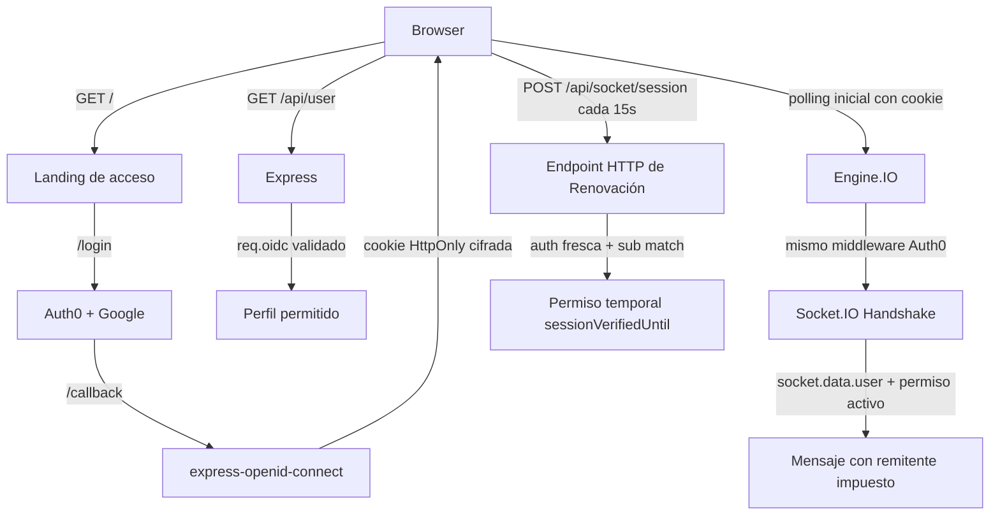

# US-01 Autenticación social con Auth0

UNA Chat usa Auth0 como cliente OIDC confidencial para que una persona inicie sesión con Google sin que la aplicación gestione contraseñas locales. La sesión se valida exclusivamente en el servidor mediante `express-openid-connect`; el navegador no recibe tokens ni secretos.

## Estado verificable

- El flujo real local con Google, consentimiento Auth0, retorno al chat, perfil, mensajes y logout fue comprobado manualmente por el propietario el 2026-10-29.
- `npm run test:all` ejecuta **99 pruebas: 54 unitarias, 34 de integración y 11 E2E: 99/99 aprobadas (0 fallos)**.
- `node --test factory/tests/factory.test.mjs` ejecuta **20/20 aprobadas**.
- El flujo equivalente en Vercel aún no se ha desplegado ni probado. No debe declararse funcional hasta completar la sección de verificación de producción.

## Arquitectura



`/` sólo sirve la pantalla de acceso sin transcript ni datos privados. `/chat` y `/public` requieren `requiresAuth()`. `/api/user` devuelve únicamente `sub`, nombre visible y, si existen, correo y avatar permitidos desde un `req.oidc` previamente validado; responde con `Cache-Control: no-store`.

### Ciclo de vida y renovación de permisos en Socket.IO

Para evitar que una conexión Socket.IO conserve autorización indefinidamente tras expirar la cookie HTTP o tras cerrar sesión en otra pestaña:
1. **Handshake inicial:** Socket.IO exige un handshake de **polling HTTP** autenticado con el middleware oficial de Auth0. En producción, verifica el `Origin` configurado o Fetch Metadata `same-origin`.
2. **Endpoint de renovación `POST /api/socket/session`:** Cada conexión requiere validar su permiso de mensajería a través de una petición HTTP fresca gobernada por `auth()`. La aplicación valida que el sujeto autenticado en HTTP (`user.sub`) coincida exactamente con la identidad original del socket (`socket.data.user.sub`). Peticiones anónimas, sockets inexistentes o intentos de renovar conexiones ajenas se rechazan con HTTP 401.
3. **Expiración temporal:** El permiso de envío se otorga con un TTL estricto (`socketSessionMaxAgeMs = 30000 ms`). El navegador renueva este permiso cada 15 segundos.
4. **Desconexión forzada:** Si un socket intenta emitir un mensaje sin un permiso vigente o con sesión vencida, el servidor desconecta inmediatamente la conexión (`socket.disconnect(true)`).

### Entry Point de Vercel y Servido de Recursos Privados

- **Export HTTP Server:** [despues/server.js](server.js) exporta directamente la instancia de `http.Server` (`module.exports = defaultServer` con propiedad `.default = defaultServer`), cumpliendo con la especificación oficial de Vercel para WebSocket Functions.
- **Recursos privados en `private-assets/`:** La documentación de Express en Vercel advierte que `express.static()` no es compatible con el modelo de ejecución serverless de Vercel Functions. Por ello, los archivos bajo `/public/*` se sirven mediante un manejador Express dedicado con `fs.createReadStream`, protegido por `requiresAuth()`, con validación estricta contra ataques de directory traversal (`..`) y cabeceras `Cache-Control: private, no-cache`.

## Instalación local

```powershell
cd despues
Copy-Item .env.example .env
npm install
npm start
```

Complete exclusivamente el archivo local `.env` con:

| Variable | Uso |
|---|---|
| `AUTH0_SECRET` | Secreto aleatorio de al menos 32 caracteres para la cookie de sesión cifrada. |
| `AUTH0_BASE_URL` | `http://localhost:3000` en desarrollo. |
| `AUTH0_CLIENT_ID` | Client ID de una Regular Web Application de Auth0. |
| `AUTH0_CLIENT_SECRET` | Client Secret de esa aplicación; nunca se publica. |
| `AUTH0_ISSUER_BASE_URL` | URL HTTPS del tenant Auth0. |
| `AUTH0_CONNECTION` | Opcional; por ejemplo, `google-oauth2`. |

En Auth0, mantenga estas URLs locales:

```text
Allowed Callback URLs: http://localhost:3000/callback
Allowed Logout URLs:   http://localhost:3000
Allowed Web Origins:   http://localhost:3000
```

No copie valores de `.env` a documentación, capturas, GitHub ni Vercel CLI. `.env.example` contiene sólo marcadores de posición.

## Controles de seguridad

- `auth()` del SDK administra state, nonce, PKCE, callback y la cookie cifrada; el proyecto no descifra cookies ni valida JWTs de forma artesanal.
- Cookies de sesión: `HttpOnly`, `SameSite=Lax`, `path=/`, duración absoluta de 7 días y rolling de 24 horas. Bajo HTTPS se usa `Secure` y el prefijo `__Host-`; HTTP se limita a localhost.
- `requiresAuth()` controla rutas privadas. El perfil se obtiene de `req.oidc.isAuthenticated()` y `req.oidc.user` sólo después de validación del SDK.
- Los eventos Socket.IO comprueban la vigencia de `sessionVerifiedUntil` renovada por HTTP antes de retransmitirse y desconectan la sesión vencida. Un payload que redefine `hasOwnProperty` se rechaza de forma segura; ningún método del objeto no confiable se invoca.
- Las respuestas HTML establecen CSP restrictiva, `X-Content-Type-Options: nosniff`, `Referrer-Policy: no-referrer`, COOP/CORP y HSTS bajo HTTPS de producción. Un error de `/callback` redirige a un aviso genérico de reintento sin reflejar detalles de Auth0.
- La interfaz usa nodos DOM y `textContent`; URL de multimedia y color se validan. REQ-010, REQ-011 y REQ-012 se comprueban tanto en cliente como servidor.
- La auditoría `npm audit --json` reportó **0 vulnerabilidades** sobre dependencias resueltas.

## Evidencias publicables

Las copias siguientes fueron redaccionadas para eliminar nombre, correo e información de URL/sesión. Los originales locales se excluyen de Git en `docs/evidence/private/`.

1. [Consentimiento de Auth0 (redactado)](../evidence/us-01-auth0/01-consentimiento-auth0-redactada.png)
2. [Chat con identidad autenticada (redactado)](../evidence/us-01-auth0/02-chat-autenticado-redactada.png)
3. [Chat con mensajes enviados (redactado)](../evidence/us-01-auth0/03-chat-mensajes-redactada.png)

## Criterios de aceptación

| # | Criterio | Estado real |
|---:|---|---|
| 1 | Cuenta y aplicación personal Auth0 | Comprobado por el propietario en localhost. |
| 2 | Proveedor social | Google comprobado por el propietario. |
| 3 | URLs local y Vercel | Local configurado; URLs Vercel pendientes del dominio real. |
| 4 | Login local | Comprobado manualmente por el propietario. |
| 5 | Identidad y logout | Comprobados manualmente; cubiertos por E2E controlado. |
| 6 | HTTP y Socket.IO protegidos | Cubierto por integración: anónimo, cookie falsa, upgrade directo y suplantación rechazados. |
| 7 | Flujo Vercel | Pendiente de despliegue autorizado y prueba real. |
| 8 | Variables y secretos | `.env` ignorado; plantilla sin secretos; revisión de archivos publicables limpia. |
| 9 | Cancelación/error OAuth | Error y cancelación controlados cubiertos por integración/E2E; cancelación real por la persona usuaria sigue pendiente de prueba manual. |

## Vercel: preparación, multi-instancia y límite de validación

El proyecto Vercel debe configurarse con **Root Directory: `despues`**, Node.js 20 o superior (según `package.json`) y las cinco variables `AUTH0_*` como variables privadas en Project Settings. Cuando Vercel asigne el dominio, agregue, sin sustituir localhost:

```text
Allowed Callback URLs: https://DOMINIO/callback
Allowed Logout URLs:   https://DOMINIO
Allowed Web Origins:   https://DOMINIO
```

Vercel anunció soporte para WebSockets en Vercel Functions (con Fluid Compute); esto habilita conexiones persistentes, pero introduce consideraciones operacionales clave en arquitecturas distribuidas:

### Análisis Multi-Instancia en Vercel Serverless

1. **Afinidad de Handshake (Engine.IO Polling):**
   - El protocolo Engine.IO inicia con peticiones HTTP de polling (`GET` y `POST`) para negociar el `sid`.
   - Si una solicitud posterior de polling llega a una instancia de Lambda distinta a la que originó el `sid`, responderá `400 Session ID unknown`.
   - *Mitigación en Vercel:* Con Fluid Compute, las conexiones que efectúan upgrade a WebSocket quedan fijadas (*pinned*) a la misma instancia durante su ciclo de vida.
2. **Enrutamiento de `/api/socket/session`:**
   - La petición HTTP `POST /api/socket/session` viaja de forma independiente a la conexión WebSocket.
   - Si la petición HTTP cae en una instancia diferente a la que mantiene el socket en memoria, la búsqueda en memoria local `io.sockets.sockets.get(socketId)` resultará nula.
3. **Broadcast entre Instancias (`io.emit`):**
   - El adaptador en memoria por defecto de Socket.IO solo retransmite a sockets conectados a la misma instancia.
   - Si el usuario A está conectado a la Instancia 1 y el usuario B a la Instancia 2, los mensajes de A no llegarán a B a menos que exista una capa de transporte compartida.

### Infraestructura Compartida Requerida (Solución Mínima Segura)

Para habilitar escalabilidad horizontal multi-instancia en producción en Vercel, es indispensable distinguir los distintos problemas arquitectónicos y no asumir que una sola herramienta resuelve todos:

1. **Retransmisión de Eventos (`io.emit`):**
   - `@socket.io/redis-adapter` (apoyado en Upstash Redis con TLS) resuelve **únicamente** la distribución de mensajes Socket.IO entre múltiples servidores/lambdas mediante Redis Pub/Sub.
2. **Afinidad de Handshake (Engine.IO Polling):**
   - El Redis Adapter **no** resuelve la afinidad de polling. Si las peticiones HTTP iniciales de Engine.IO caen en instancias distintas, el handshake falla con `Session ID unknown`. Para resolverlo se requiere:
     - Afinidad de sesión (*Session Affinity / Sticky Sessions*) a nivel de enrutador o proxy perimetral de Vercel.
     - O forzar transporte directo WebSocket (`transports: ['websocket']`) omitiendo el polling.
3. **Renovación HTTP de Permisos (`/api/socket/session`):**
   - El Redis Adapter tampoco intercepta ni gestiona peticiones HTTP de Express. La renovación periódica de permisos de socket a través de HTTP requiere:
     - Un almacén de datos distribuido independiente (por ejemplo, Redis Key-Value / Upstash KV con comandos `SET/GET` y TTL de 30s) donde cualquier instancia pueda consultar y validar `socket_session:<socketId>`.
     - O enrutamiento con afinidad de sesión hacia la instancia que retiene la conexión del socket.

- **Entorno Actual (Preview Mono-Instancia):**
  - En entornos de preview de Vercel bajo Fluid Compute con baja concurrencia, una sola instancia atiende las conexiones, permitiendo validar el flujo E2E sin infraestructura externa adicional. El aprovisionamiento de Redis Pub/Sub, almacén KV de sesiones de socket y afinidad de red quedan identificados como los requisitos para producción multi-instancia.

## Verificación de producción posterior al despliegue

1. Abra la URL HTTPS y valide redirección a Auth0 y Google.
2. Compruebe callback HTTPS, sesión persistente, perfil, envío/recepción entre dos usuarios autenticados y logout.
3. Compruebe rechazo anónimo, cookie falsa, WebSocket directo y nombre remitente manipulado.
4. Cancele un login y fuerce un error controlado de callback para verificar un mensaje claro y reintento.
5. Tras logout, solicite `/chat` y confirme que no entrega contenido privado.

## Memoria y Factory

El Second Brain vive en `brain/`: `daily-log/status.md` mantiene el estado actual y `Working/Tickets and recent work.md` conserva decisiones durables. La Factory en `factory/` ejecuta intake, spec, TDD, cuatro revisiones independientes, clasificación de riesgo y compuerta humana. Esta historia es de riesgo alto por modificar backend, OAuth y dependencias: requiere aprobación humana antes de release/merge.
