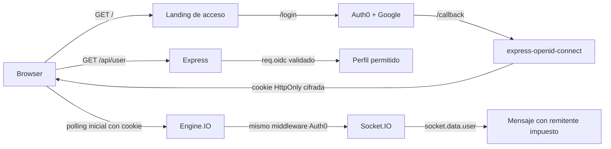

# US-01 Autenticación social con Auth0

UNA Chat usa Auth0 como cliente OIDC confidencial para que una persona inicie sesión con Google sin que la aplicación gestione contraseñas locales. La sesión se valida exclusivamente en el servidor mediante `express-openid-connect`; el navegador no recibe tokens ni secretos.

## Estado verificable

- El flujo real local con Google, consentimiento Auth0, retorno al chat, perfil, mensajes y logout fue comprobado manualmente por el propietario el 2026-10-29.
- `npm run test:all` ejecutó **54 pruebas unitarias, 27 de integración y 11 E2E: 92/92 aprobadas**.
- `node --test factory/tests/factory.test.mjs` ejecutó **20/20 aprobadas**.
- El flujo equivalente en Vercel aún no se ha desplegado ni probado. No debe declararse funcional hasta completar la sección de verificación de producción.

## Arquitectura



`/` sólo sirve la pantalla de acceso sin transcript ni datos privados. `/chat` y `/public` requieren `requiresAuth()`. `/api/user` devuelve únicamente `sub`, nombre visible y, si existen, correo y avatar permitidos desde un `req.oidc` previamente validado; responde con `Cache-Control: no-store`.

Socket.IO exige primero un handshake de **polling HTTP** autenticado. En producción, acepta un `Origin` idéntico a `AUTH0_BASE_URL`; Chromium puede omitir ese encabezado en un GET de mismo origen, por lo que se admite únicamente el caso con Fetch Metadata `Sec-Fetch-Site: same-origin` y autoridad de host configurada. El upgrade WebSocket directo, una sesión anónima, un polling sin esas pruebas y una cookie `appSession` falsificada se rechazan. En cada evento se vuelve a consultar el contexto Auth0 del request y el servidor sustituye cualquier `nombre` del cliente por esa identidad.

## Instalación local

```powershell
cd despues
Copy-Item .env.example .env
npm install
npm start
```

Complete exclusivamente el archivo local `.env` con:

| Variable | Uso |
|---|---|
| `AUTH0_SECRET` | Secreto aleatorio de al menos 32 caracteres para la cookie de sesión cifrada. |
| `AUTH0_BASE_URL` | `http://localhost:3000` en desarrollo. |
| `AUTH0_CLIENT_ID` | Client ID de una Regular Web Application de Auth0. |
| `AUTH0_CLIENT_SECRET` | Client Secret de esa aplicación; nunca se publica. |
| `AUTH0_ISSUER_BASE_URL` | URL HTTPS del tenant Auth0. |
| `AUTH0_CONNECTION` | Opcional; por ejemplo, `google-oauth2`. |

En Auth0, mantenga estas URLs locales:

```text
Allowed Callback URLs: http://localhost:3000/callback
Allowed Logout URLs:   http://localhost:3000
Allowed Web Origins:   http://localhost:3000
```

No copie valores de `.env` a documentación, capturas, GitHub ni Vercel CLI. `.env.example` contiene sólo marcadores de posición.

## Controles de seguridad

- `auth()` del SDK administra state, nonce, PKCE, callback y la cookie cifrada; el proyecto no descifra cookies ni valida JWTs de forma artesanal.
- Cookies de sesión: `HttpOnly`, `SameSite=Lax`, `path=/`, duración absoluta de 7 días y rolling de 24 horas. Bajo HTTPS se usa `Secure` y el prefijo `__Host-`; HTTP se limita a localhost.
- `requiresAuth()` controla rutas privadas. El perfil se obtiene de `req.oidc.isAuthenticated()` y `req.oidc.user` sólo después de validación del SDK.
- Los eventos Socket.IO vuelven a comprobar `req.oidc.isAuthenticated()` antes de retransmitirse y desconectan la sesión cuyo contexto ya no es válido. Un payload que redefine `hasOwnProperty` se rechaza de forma segura; ningún método del objeto no confiable se invoca.
- Las respuestas HTML establecen CSP restrictiva, `X-Content-Type-Options: nosniff`, `Referrer-Policy: no-referrer`, COOP/CORP y HSTS bajo HTTPS de producción. Un error de `/callback` redirige a un aviso genérico de reintento sin reflejar detalles de Auth0.
- La interfaz usa nodos DOM y `textContent`; URL de multimedia y color se validan. REQ-010, REQ-011 y REQ-012 se comprueban tanto en cliente como servidor.
- La auditoría `npm audit --json` del 2026-10-29 reportó **0 vulnerabilidades** sobre 213 dependencias resueltas.

## Evidencias publicables

Las copias siguientes fueron redaccionadas para eliminar nombre, correo e información de URL/sesión. Los originales locales se excluyen de Git en `docs/evidence/private/`.

1. [Consentimiento de Auth0 (redactado)](../evidence/us-01-auth0/01-consentimiento-auth0-redactada.png)
2. [Chat con identidad autenticada (redactado)](../evidence/us-01-auth0/02-chat-autenticado-redactada.png)
3. [Chat con mensajes enviados (redactado)](../evidence/us-01-auth0/03-chat-mensajes-redactada.png)

## Criterios de aceptación

| # | Criterio | Estado real |
|---:|---|---|
| 1 | Cuenta y aplicación personal Auth0 | Comprobado por el propietario en localhost. |
| 2 | Proveedor social | Google comprobado por el propietario. |
| 3 | URLs local y Vercel | Local configurado; URLs Vercel pendientes del dominio real. |
| 4 | Login local | Comprobado manualmente por el propietario. |
| 5 | Identidad y logout | Comprobados manualmente; cubiertos por E2E controlado. |
| 6 | HTTP y Socket.IO protegidos | Cubierto por integración: anónimo, cookie falsa, upgrade directo y suplantación rechazados. |
| 7 | Flujo Vercel | Pendiente de despliegue autorizado y prueba real. |
| 8 | Variables y secretos | `.env` ignorado; plantilla sin secretos; revisión de archivos publicables limpia. |
| 9 | Cancelación/error OAuth | Error y cancelación controlados cubiertos por integración/E2E; cancelación real por la persona usuaria sigue pendiente de prueba manual. |

## Vercel: preparación y límite de validación

El proyecto Vercel debe configurarse con **Root Directory: `despues`**, Node.js 20 o superior (según `package.json`) y las cinco variables `AUTH0_*` como variables privadas en Project Settings. Cuando Vercel asigne el dominio, agregue, sin sustituir localhost:

```text
Allowed Callback URLs: https://DOMINIO/callback
Allowed Logout URLs:   https://DOMINIO
Allowed Web Origins:   https://DOMINIO
```

Vercel anunció disponibilidad general de WebSockets en Functions el 20 de octubre de 2026 y soporte para Socket.IO; esto elimina la incompatibilidad histórica, pero no reemplaza una prueba en el proyecto real. `server.js` es el entry point de Node reconocido por el despliegue zero-config; `vercel.json` sólo declara el esquema actual y Fluid Compute, sin el `builds` heredado. Las funciones Vercel sirven `public/` desde CDN antes de Express: por eso los recursos privados viven en `private-assets/` y siguen pasando por `/public` + `requiresAuth()`. Antes de publicar, pruebe un deployment de preview con el polling autenticado; el servidor no debe aceptar upgrade directo ni desactivar la validación de sesión para adaptarse a Vercel.

La cookie de sesión es stateless y no depende de memoria de proceso. Sin embargo, el broadcast actual de Socket.IO es local a cada instancia de Function: Vercel puede ubicar clientes en instancias distintas. La comunicación multiinstancia requiere un adaptador compartido (por ejemplo, Redis) y queda fuera de US-01. La compatibilidad operacional de Engine.IO polling + upgrade en Vercel sigue **pendiente de prueba de producción**.

## Verificación de producción posterior al despliegue

1. Abra la URL HTTPS y valide redirección a Auth0 y Google.
2. Compruebe callback HTTPS, sesión persistente, perfil, envío/recepción entre dos usuarios autenticados y logout.
3. Compruebe rechazo anónimo, cookie falsa, WebSocket directo y nombre remitente manipulado.
4. Cancele un login y fuerce un error controlado de callback para verificar un mensaje claro y reintento.
5. Tras logout, solicite `/chat` y confirme que no entrega contenido privado.

## Memoria y Factory

El Second Brain vive en `brain/`: `daily-log/status.md` mantiene el estado actual y `Working/Tickets and recent work.md` conserva decisiones durables. El rsc-harness histórico del Laboratorio 5 permanece aislado e intacto; su papel es el de arnés previo de OpenSpec/FoFo, no de sustituto de la validación Auth0. La Factory en `factory/` ejecuta intake, spec, TDD, cuatro revisiones independientes, clasificación de riesgo y compuerta humana. Esta historia es de riesgo alto por modificar backend, OAuth y dependencias: requiere aprobación humana antes de release/merge.

La CSP mantiene `unsafe-inline` sólo para el script y estilos ya presentes en esta interfaz estática. Una mejora posterior, fuera de esta historia, sería extraerlos o aplicar nonces/hashes para eliminar esa excepción sin romper la pantalla de login.
