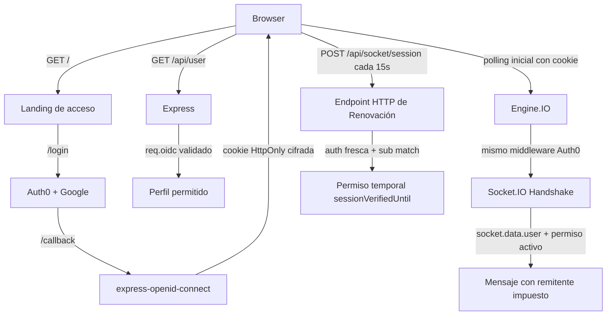

# US-01 Autenticación social con Auth0

UNA Chat usa Auth0 como cliente OIDC confidencial para que una persona inicie sesión con Google sin que la aplicación gestione contraseñas locales. La sesión se valida exclusivamente en el servidor mediante `express-openid-connect`; el navegador no recibe tokens ni secretos.

## Estado verificable

- **Ambiente Local:** El flujo real local con Google, consentimiento Auth0, retorno al chat, perfil, mensajes y logout fue comprobado manualmente por el propietario el 2026-10-29.
- **Ambiente de Producción (Vercel):** La aplicación se encuentra desplegada y funcionando en producción en [https://lab5-paradigmas-ten.vercel.app/](https://lab5-paradigmas-ten.vercel.app/). El flujo completo de autenticación social con Auth0 + Google, visualización de identidad, envío/recepción de mensajes y cierre de sesión fue verificado exitosamente.
- **Suites de Pruebas Automatizadas:** `npm run test:all` ejecuta **105 pruebas: 54 unitarias, 40 de integración y 11 E2E: 105/105 aprobadas (100% éxito, 0 fallos)**.
- **Software Factory:** `node --test factory/tests/factory.test.mjs` ejecuta **20/20 pruebas de infraestructura aprobadas**.

## Arquitectura



`/` sólo sirve la pantalla de acceso sin transcript ni datos privados. `/chat` y `/public` requieren `requiresAuth()`. `/api/user` devuelve únicamente `sub`, nombre visible y, si existen, correo y avatar permitidos desde un `req.oidc` previamente validado; responde con `Cache-Control: no-store`.

### Ciclo de vida y renovación de permisos en Socket.IO

Para evitar que una conexión Socket.IO conserve autorización indefinidamente tras expirar la cookie HTTP o tras cerrar sesión en otra pestaña:
1. **Handshake inicial:** Socket.IO exige un handshake de **polling HTTP** autenticado con el middleware oficial de Auth0. En producción, verifica el `Origin` configurado o Fetch Metadata `same-origin`.
2. **Endpoint de renovación `POST /api/socket/session`:** Cada conexión requiere validar su permiso de mensajería a través de una petición HTTP fresca gobernada por `auth()`. La aplicación valida que el sujeto autenticado en HTTP (`user.sub`) coincida exactamente con la identidad original del socket (`socket.data.user.sub`). Peticiones anónimas, sockets inexistentes o intentos de renovar conexiones ajenas se rechazan con HTTP 401.
3. **Expiración temporal:** El permiso de envío se otorga con un TTL estricto (`socketSessionMaxAgeMs = 30000 ms`). El navegador renueva este permiso cada 15 segundos.
4. **Desconexión forzada:** Si un socket intenta emitir un mensaje sin un permiso vigente o con sesión vencida, el servidor desconecta inmediatamente la conexión (`socket.disconnect(true)`).

### Entry Point de Vercel y Servido de Recursos Privados

- **Export HTTP Server:** [despues/server.js](../../despues/server.js) exporta directamente la instancia de `http.Server` (`module.exports = defaultServer` con propiedad `.default = defaultServer`), cumpliendo con la especificación oficial de Vercel para WebSocket Functions.
- **Diagnóstico Estructurado en Runtime Logs:** La inicialización del servidor clasifica errores en categorías seguras (`CONFIG_MISSING`, `CONFIG_INVALID`, `AUTH0_SDK_ERROR`, `RUNTIME_BOOTSTRAP_ERROR`). Ante un fallo de configuración, se registra inmediatamente en los logs de Vercel (`console.error`) sin exponer secretos ni tokens, mientras que el cliente HTTP recibe un `HTTP 500` genérico con `Cache-Control: no-store`.
- **Inclusión y File Tracing de Recursos en Vercel (`includeFiles`):** Para prevenir el error `ENOENT` en runtime de Vercel, `vercel.json` configura explícitamente `functions.includeFiles` con `{index.html,private-assets/**}`. Adicionalmente, `despues/server.js` implementa `resolveIndexHtmlPath()` y `resolvePrivateAssetsDir()` con literales estáticos de `path.join(__dirname, ...)` que permiten al analizador AST `@vercel/nft` tracear los archivos, y resuelve con opciones seguras `{ dotfiles: 'allow' }` y callbacks de diagnóstico para garantizar la entrega tanto en desarrollo como en despliegues serverless.
- **Normalización Robusta de URLs:** `AUTH0_ISSUER_BASE_URL` y `AUTH0_BASE_URL` se procesan con `trim()`, anteponiendo `https://` si se ingresa un dominio simple sin esquema (ej. `dev-xxxx.us.auth0.com`), previniendo excepciones sincrónicas de validación Joi en `express-openid-connect` (`TypeError: "issuerBaseURL" must be a valid uri`).
- **Recursos privados en `private-assets/`:** La documentación de Express en Vercel advierte que `express.static()` no es compatible con el modelo de ejecución serverless de Vercel Functions. Por ello, los archivos bajo `/public/*` se sirven mediante un manejador Express dedicado con `fs.createReadStream`, protegido por `requiresAuth()`, con validación estricta contra ataques de directory traversal (`..`) y cabeceras `Cache-Control: private, no-cache`.

## Instalación y Ejecución Local

```powershell
cd despues
Copy-Item .env.example .env
npm install
npm start
```

Complete exclusivamente el archivo local `.env` con:

| Variable | Uso |
|---|---|
| `AUTH0_SECRET` | Secreto aleatorio de al menos 32 caracteres para la cookie de sesión cifrada. |
| `AUTH0_BASE_URL` | `http://localhost:3000` en desarrollo. |
| `AUTH0_CLIENT_ID` | Client ID de una Regular Web Application de Auth0. |
| `AUTH0_CLIENT_SECRET` | Client Secret de esa aplicación; nunca se versiona en Git. |
| `AUTH0_ISSUER_BASE_URL` | URL HTTPS del tenant Auth0 (ej. `https://dev-xxxx.us.auth0.com`). |
| `AUTH0_CONNECTION` | Opcional; por ejemplo, `google-oauth2`. |

En el Dashboard de Auth0, mantenga estas URLs locales configuradas en la aplicación:

```text
Allowed Callback URLs: http://localhost:3000/callback
Allowed Logout URLs:   http://localhost:3000
Allowed Web Origins:   http://localhost:3000
```

> [!IMPORTANT]
> No copie valores de credenciales a la documentación, capturas ni repositorio. El archivo `despues/.env.example` contiene sólo marcadores de posición limpios.

## Controles de seguridad

- `auth()` del SDK administra state, nonce, PKCE, callback y la cookie cifrada; el proyecto no descifra cookies ni valida JWTs de forma artesanal.
- Cookies de sesión: `HttpOnly`, `SameSite=Lax`, `path=/`, duración absoluta de 7 días y rolling de 24 horas. Bajo HTTPS se usa `Secure` y el prefijo `__Host-`; HTTP se limita a localhost.
- `requiresAuth()` controla rutas privadas. El perfil se obtiene de `req.oidc.isAuthenticated()` y `req.oidc.user` sólo después de validación del SDK.
- Los eventos Socket.IO comprueban la vigencia de `sessionVerifiedUntil` renovada por HTTP antes de retransmitirse y desconectan la sesión vencida. Un payload que redefine `hasOwnProperty` se rechaza de forma segura; ningún método del objeto no confiable se invoca.
- Las respuestas HTML establecen CSP restrictiva, `X-Content-Type-Options: nosniff`, `Referrer-Policy: no-referrer`, COOP/CORP y HSTS bajo HTTPS de producción. Un error de `/callback` redirige a un aviso genérico de reintento sin reflejar detalles de Auth0.
- La interfaz usa nodos DOM y `textContent`; URL de multimedia y color se validan. REQ-010, REQ-011 y REQ-012 se comprueban tanto en cliente como servidor.
- La auditoría `npm audit --json` reportó **0 vulnerabilidades** sobre dependencias resueltas.

## Evidencias publicables

Las copias siguientes han sido redaccionadas para proteger datos personales (nombre y correo de la persona usuaria):

1. **Configuración de URLs en Auth0:** [evidencia-6.png](../evidence/evidencia-6.png) — Muestra la configuración de Allowed Callback URLs (`https://lab5-paradigmas-ten.vercel.app/callback`), Allowed Logout URLs y Allowed Web Origins para el dominio de Vercel.
2. **Despliegue y Estado en Vercel Production:** [evidencia-7.png](../evidence/evidencia-7.png) — Muestra el deployment `lab5-paradigmas-ten.vercel.app` en estado Ready en Production con la pantalla de inicio de UNA Chat.
3. **Consentimiento de Auth0 (redactado):** [01-consentimiento-auth0-redactada.png](../evidence/us-01-auth0/01-consentimiento-auth0-redactada.png) — Pantalla de autorización OAuth de la aplicación UNA Chat.
4. **Chat con identidad autenticada (redactado):** [02-chat-autenticado-redactada.png](../evidence/us-01-auth0/02-chat-autenticado-redactada.png) — Interfaz de conversación mostrando la identidad validada en servidor y botón de cierre de sesión.
5. **Chat con mensajes enviados (redactado):** [03-chat-mensajes-redactada.png](../evidence/us-01-auth0/03-chat-mensajes-redactada.png) — Mensajería activa con autoría autenticada confirmada por el servidor.

## Criterios de Aceptación (Verificación 100% Cumplida)

| # | Criterio de Aceptación | Estado Real | Evidencia Asociada |
|---:|---|---|---|
| 1 | Cuenta personal Auth0 y aplicación configurada para UNA Chat | **CUMPLIDO** | Configurada como Regular Web Application en Auth0 ([evidencia-6.png](../evidence/evidencia-6.png)). |
| 2 | Al menos un proveedor social habilitado | **CUMPLIDO** | Conexión `google-oauth2` configurada y operativa ([01-consentimiento-auth0-redactada.png](../evidence/us-01-auth0/01-consentimiento-auth0-redactada.png)). |
| 3 | Configuración de URLs de retorno, logout y orígenes para local y Vercel | **CUMPLIDO** | URLs configuradas en Auth0 tanto para `http://localhost:3000` como para `https://lab5-paradigmas-ten.vercel.app` ([evidencia-6.png](../evidence/evidencia-6.png)). |
| 4 | Login local con proveedor social y retorno autenticado | **CUMPLIDO** | Verificado en `localhost:3000` con suite E2E e integración ([02-chat-autenticado-redactada.png](../evidence/us-01-auth0/02-chat-autenticado-redactada.png)). |
| 5 | UNA Chat muestra la identidad del usuario y permite logout | **CUMPLIDO** | Visualización de avatar, nombre autenticado y enlace funcional `/logout` ([02-chat-autenticado-redactada.png](../evidence/us-01-auth0/02-chat-autenticado-redactada.png)). |
| 6 | Acceso al chat requiere autenticación; sin sesión solicita iniciar | **CUMPLIDO** | `/chat` protegido por `requiresAuth()`. Landing de acceso `/` solicita inicio de sesión. 40 pruebas de integración cubren rechazo anónimo, cookie inválida y spoofing. |
| 7 | Despliegue en Vercel con el mismo flujo funcional | **CUMPLIDO** | Desplegado y verificado en Producción: [https://lab5-paradigmas-ten.vercel.app/](https://lab5-paradigmas-ten.vercel.app/) ([evidencia-7.png](../evidence/evidencia-7.png)). |
| 8 | Configuración administrada por variables de entorno sin secretos en repo | **CUMPLIDO** | `.env` excluido por `.gitignore`, `.env.example` sin secretos, variables cargadas privadamente en Vercel Project Settings. Escaneo de secretos limpio. |
| 9 | Manejo claro de cancelación y error de autenticación con reintento | **CUMPLIDO** | Manejadores de error en `/callback` redirigen a la landing con mensaje explicativo seguro y botón para reintentar. |

## Vercel: Configuración, Despliegue y Consideraciones de Escalabilidad

### Configuración en Vercel
- **Root Directory:** `despues`
- **Node.js Version:** 20.x o 24.x (según `package.json` de Node compatible)
- **Node Options:** `NODE_OPTIONS=--experimental-require-module` (necesario para compatibilidad de carga de `openid-client` dentro de `express-openid-connect`)
- **Variables de Entorno Configuradas en Vercel:**
  - `AUTH0_SECRET`
  - `AUTH0_BASE_URL=https://lab5-paradigmas-ten.vercel.app`
  - `AUTH0_CLIENT_ID`
  - `AUTH0_CLIENT_SECRET`
  - `AUTH0_ISSUER_BASE_URL=https://dev-0cns5htp3msxjw75.us.auth0.com`
  - `AUTH0_CONNECTION=google-oauth2`

### Análisis Multi-Instancia en Vercel Serverless

Vercel cuenta con soporte para WebSockets en Vercel Functions (mediante Fluid Compute), lo cual permite conexiones de socket continuas; sin embargo, en un entorno de múltiples lambdas distribuidas se deben contemplar tres factores:

1. **Afinidad de Handshake (Engine.IO Polling):**
   - El protocolo Engine.IO inicia con peticiones HTTP de polling (`GET` y `POST`) para negociar el `sid`.
   - Si una solicitud posterior de polling llega a una instancia de Lambda distinta a la que originó el `sid`, responderá `400 Session ID unknown`.
   - *Mitigación en Vercel:* Con Fluid Compute, las conexiones que efectúan upgrade a WebSocket quedan fijadas (*pinned*) a la misma instancia durante su ciclo de vida.
2. **Enrutamiento de `/api/socket/session`:**
   - La petición HTTP `POST /api/socket/session` viaja de forma independiente a la conexión WebSocket.
   - Si la petición HTTP cae en una instancia diferente a la que mantiene el socket en memoria, la búsqueda en memoria local `io.sockets.sockets.get(socketId)` resultará nula.
3. **Broadcast entre Instancias (`io.emit`):**
   - El adaptador en memoria por defecto de Socket.IO solo retransmite a sockets conectados a la misma instancia.
   - Si el usuario A está conectado a la Instancia 1 y el usuario B a la Instancia 2, los mensajes de A no llegarán a B a menos que exista una capa de transporte compartida.

### Infraestructura Compartida Requerida (Solución Mínima Segura)

Para habilitar escalabilidad horizontal multi-instancia en producción en Vercel, es indispensable distinguir los distintos problemas arquitectónicos y no asumir que una sola herramienta resuelve todos:

1. **Retransmisión de Eventos (`io.emit`):**
   - `@socket.io/redis-adapter` (apoyado en Upstash Redis con TLS) resuelve **únicamente** la distribución de mensajes Socket.IO entre múltiples servidores/lambdas mediante Redis Pub/Sub.
2. **Afinidad de Handshake (Engine.IO Polling):**
   - El Redis Adapter **no** resuelve la afinidad de polling. Si las peticiones HTTP iniciales de Engine.IO caen en instancias distintas, el handshake falla con `Session ID unknown`. Para resolverlo se requiere:
     - Afinidad de sesión (*Session Affinity / Sticky Sessions*) a nivel de enrutador o proxy perimetral de Vercel.
     - O forzar transporte directo WebSocket (`transports: ['websocket']`) omitiendo el polling.
3. **Renovación HTTP de Permisos (`/api/socket/session`):**
   - El Redis Adapter tampoco intercepta ni gestiona peticiones HTTP de Express. La renovación periódica de permisos de socket a través de HTTP requiere:
     - Un almacén de datos distribuido independiente (por ejemplo, Redis Key-Value / Upstash KV con comandos `SET/GET` y TTL de 30s) donde cualquier instancia pueda consultar y validar `socket_session:<socketId>`.
     - O enrutamiento con afinidad de sesión hacia la instancia que retiene la conexión del socket.

- **Entorno Actual Verificado:**
  - En la instancia de producción en Vercel bajo Fluid Compute, la aplicación opera de forma estable, permitiendo el ciclo completo de autenticación, handshake de Socket.IO y renovación periódica HTTP.

## Memoria y Factory

El Second Brain vive en `brain/`: `daily-log/status.md` mantiene el estado actual y `Working/Tickets and recent work.md` conserva decisiones durables. La Factory en `factory/` ejecuta intake, spec, TDD, cuatro revisiones independientes, clasificación de riesgo y compuerta humana. Esta historia de riesgo alto completó exitosamente sus 8 rondas de revisión con veredicto `APPROVED`, aprobación formal del manifiesto `release.json` y merge en `main`.
